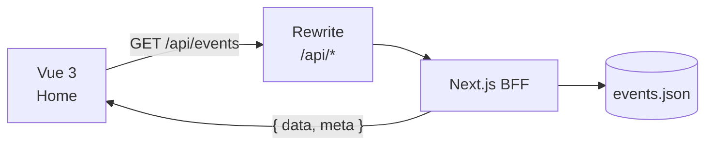

# Apresentação — Integração Front-End × Back-End

> **Projeto:** Pará Eventos · **Atividade:** Evolução do Projeto com Integração Back-End
> **Formato:** capa + 4 slides · até 5 minutos · 3 integrantes
> **Uso:** guia de montagem (texto pronto para colar) + roteiro de fala + checklist.
> **Base visual:** `Para-Eventos.pptx` (apresentação anterior) — manter o mesmo template.
> **Arquivo pronto:** `Para-Eventos-Integracao-API.pptx` (capa + 4 slides, já com prints reais).

---

## 0. Resumo executivo

| Item | Valor |
|---|---|
| Integrantes | Marcelo Cruz (04222991) · Eduardo Ximenes (04224825) · Jair Raiol Lobo Junior (26145740) |
| API | API própria (BFF) em Next.js/TypeScript, dados em `data/events.json` |
| API publicada | https://para-eventos-api.vercel.app |
| Front publicado | https://para-eventos-seven.vercel.app |
| Endpoints | `GET /api/events` · `GET /api/events/:id` · `GET /api/categories` |
| Biblioteca | Axios, isolado em `src/services/events.js` |
| Números | 23 eventos · 6 categorias · 5 destaques · 3 GETs · assets 18 MB → 456 KB |
| Divisão | Marcelo: Slide 1 + conclusão · Junior: Slide 2 · Eduardo: Slide 3 + demo |
| Demonstração | **Ao vivo** no site publicado (sem GIF/vídeo de backup) |

---

## 1. Identidade visual a manter

Extraída do PPT anterior — não criar paleta nova.

| Elemento | Valor no deck antigo |
|---|---|
| Fundo | branco |
| Cor de destaque | vinho `#562142` (rótulos, números, detalhes) |
| Texto secundário | cinza `#6C6C6C` |
| Título | Heebo Light, 32–36pt |
| Subtítulo | Heebo Light, 17,5pt, cinza |
| Rótulo de seção | caixa alta, vinho, ~12–13pt |
| Corpo | Heebo Light, 12–14pt |
| Painel de código | fundo `#24292E`, Consolas 12–13,5pt |
| Cores de sintaxe | `#C9D1D9` texto · `#79C0FF` azul · `#A5D6FF` ciano · `#7EE787` verde · `#FF7B72` vermelho · `#D2A8FF` roxo |
| Numeração | canto inferior direito, cinza claro |
| Formato | 16:9 (13,33 × 7,5 in) |

**Regras de montagem**
- 1 ideia por slide; no máximo 6 linhas de texto corrido.
- Fonte mínima 12pt no projetor; título nunca abaixo de 30pt.
- 1 print grande vale mais que 3 pequenos.
- Código: no máximo 12 linhas visíveis, 2 linhas destacadas.
- Não usar animações/transições.

---

## 2. Como montar no PowerPoint

> **O arquivo `Para-Eventos-Integracao-API.pptx` já está gerado** com capa + 4 slides, o mesmo template do deck anterior, painéis de código e três prints reais do site publicado. Use os passos abaixo apenas se precisar refazer ou ajustar a montagem.

1. Abrir `Para-Eventos.pptx` e **Salvar como** `Para-Eventos-Integracao-API.pptx`.
2. Apagar os slides 2 a 9 (conteúdo da apresentação antiga), mantendo a capa.
3. Duplicar a capa 4 vezes para herdar fontes e cores.
4. Em cada duplicata, apagar o conteúdo interno e montar com os blocos abaixo.
5. Reaproveitar componentes existentes:
   - slide 2 antigo → modelo de **rótulos de seção + bullets**;
   - slide 3 antigo → modelo de **duas colunas**;
   - slide 5 antigo → modelo de **painel de código** (copiar a caixa escura);
   - slide 9 antigo → modelo de **bloco de código + texto lateral**.
6. Inserir o número do slide no canto (formatar como cinza `#6C6C6C`, 10pt).
7. Conferir no modo apresentação a 2 m de distância.

**Prints já usados no arquivo gerado:** Home (`01-home.png`), modal (`04-modal.png`) e erro (`07-erro.png`), capturados do site em produção a 2×.

---

## 3. Capa

**Tempo:** 5 s · **Quem:** Marcelo

**Texto**
- Título: **Pará Eventos: a sua agenda de cultura e lazer**
- Subtítulo (opcional): *Agora com back-end: a agenda vem de uma API REST.*
- Integrantes: Marcelo Cruz (04222991) · Eduardo Ximenes (04224825) · Jair Raiol Lobo Junior (26145740)
- Stack: Vue 3 · Tailwind · Shadcn · **Next.js (API)**

**Visual:** a capa do arquivo gerado é a original, com "Next.js (API)" acrescentado à linha da stack. A capa não tem campo de subtítulo; se quiser incluir a frase, insira uma caixa de texto branca de 14pt logo abaixo do título.

**Fala**
> "Boa noite. Somos Marcelo, Eduardo e Jair, e vamos apresentar a evolução do Pará Eventos: a integração do front-end com um back-end próprio."

---

## 4. Slide 1 — Projeto e API escolhida

**Tempo:** 35 s · **Quem:** Marcelo · **Requisito:** API escolhida, finalidade e justificativa

### Texto para colar no slide

**Título:** A agenda agora conversa com uma API própria

**Subtítulo:** Os eventos deixaram de ser um array fixo no front e passaram a vir de um BFF em Next.js.

**`PROJETO`**
- Reunir a programação cultural e de lazer da Região Metropolitana de Belém.
- Público: moradores e visitantes que buscam eventos na região.

**`O QUE PASSOU A VIR DA API`**
- 23 eventos · 6 categorias · 5 destaques
- Imagens servidas pela API com URL absoluta

**`POR QUE UMA API PRÓPRIA`**
- Mantém os dados reais do projeto, em vez de dados genéricos.
- Permite demonstrar o ciclo completo: rota, JSON, erro e detalhe por id.
- Não depende de API pública que possa sair do ar.

**Rodapé:** `para-eventos-seven.vercel.app` · `para-eventos-api.vercel.app`

### Layout
- Esquerda (60%): título, subtítulo e os três blocos de rótulo + bullets.
- Direita (40%): diagrama em caixas, no estilo do slide 3 antigo.



### Fala
> "O Pará Eventos é uma agenda cultural feita em Vue 3. Até a entrega anterior, os 23 eventos eram um array fixo dentro da Home, e as imagens ficavam no próprio projeto. Nesta etapa, a gente criou uma API própria em Next.js e passou a consumir esses dados por HTTP. A escolha por uma API nossa foi para manter os dados reais do projeto e poder mostrar o back-end inteiro: lista, detalhe, categorias e tratamento de erro. E as imagens também passaram a vir da API, com URL absoluta."

---

## 5. Slide 2 — Integração Front-End × Back-End

**Tempo:** 75 s · **Quem:** Junior · **Requisito:** endpoint, método, código e caminho do JSON

### Texto para colar no slide

**Título:** O front pede, a API responde em JSON

**Subtítulo:** Três requisições GET concentradas em um service layer; nenhum componente visual faz HTTP.

**`ENDPOINTS`** (três cards lado a lado)

| Método | Endpoint | Para quê |
|---|---|---|
| GET | `/api/events?limit=100` | lista da Home |
| GET | `/api/events/:id` | detalhe no modal |
| GET | `/api/categories` | filtros |

**`CÓDIGO · src/services/events.js`** (painel escuro, 10 linhas, destacar as duas últimas)

```js
import axios from "axios"

const api = axios.create({
  baseURL: "/api",
  timeout: 10000,
})

export async function getEvents(params = {}) {
  const { data } = await api.get("/events", { params })
  return data
}
```

**`DO JSON À TELA`** (4 passos em linha)
1. `onMounted` chama `loadEvents()`
2. `Promise.all` busca eventos + categorias
3. Axios converte o JSON em objeto
4. `events.value` → `v-for` renderiza os cards

**`RESPOSTA`** (recorte de 4 linhas, à direita ou abaixo)

```json
{ "data": [ { "id": "show-mangueirao-2027",
  "title": "Show Nacional - Verão Amazônico 2027" } ],
  "meta": { "total": 23 } }
```

### Layout
- Faixa superior: os três cards de endpoint.
- Centro-esquerda: painel de código do service.
- Centro-direita: recorte do JSON.
- Base: os quatro passos do fluxo, com setas.

### Fala
> "A integração está toda em uma camada de serviço, o `events.js`. Nenhum componente visual faz requisição. O `axios.create` define a base `/api` e um timeout de 10 segundos. Quando a Home monta, o `onMounted` chama `loadEvents`, que usa `Promise.all` para buscar eventos e categorias em paralelo. A API responde nesse formato `{ data, meta }`. O Axios já entrega o corpo convertido em objeto, então atribuímos a `events.value`. E aí entra a reatividade do Vue: o `ref` avisa o template, o `v-for` percorre os 23 eventos e os cards aparecem. Se o usuário clica em um card, sai um segundo GET, agora em `/api/events/:id`, e o modal mostra o detalhe."

**Se o professor perguntar por `fetch()`:**
```js
const response = await fetch("/api/events?limit=100")
if (!response.ok) throw new Error(`HTTP ${response.status}`)
const { data, meta } = await response.json()
```

---

## 6. Slide 3 — Implementação e funcionalidades

**Tempo:** 75 s · **Quem:** Eduardo · **Requisito:** capturas, exibição dinâmica, interação e estados

### Texto para colar no slide

**Título:** A agenda vem do servidor, com estados de verdade

**Subtítulo:** 23 eventos e 5 destaques carregados por HTTP, com loading, erro e lista vazia tratados.

**`INTERAÇÕES`**
- Busca por título ignorando acentos — `verao` retorna 3 eventos
- Filtro por categoria vindo de `/api/categories` — `teatro` retorna 4
- Detalhe por id ao clicar no card
- Favoritos persistidos no navegador

**`ESTADOS`**
- Carregando: 8 skeletons com `animate-pulse`
- Erro: mensagem + botão **Tentar novamente**
- Sem resultados: "Nenhum evento encontrado."

**Print grande:** Home com carrossel + grid (contador "23 Eventos encontrados").
**Prints pequenos:** modal aberto · estado de erro.

### Layout
- Print grande à esquerda (60%).
- Coluna direita: blocos `INTERAÇÕES` e `ESTADOS`.
- Faixa inferior: dois prints pequenos lado a lado (modal e erro).

### Trecho de código opcional (se sobrar espaço)
```vue
<template v-if="isLoading"> ... skeletons ... </template>
<div v-else-if="loadError">
  <p>{{ loadError }}</p>
  <Button @click="loadEvents">Tentar novamente</Button>
</div>
<EventCard v-for="event in filteredEvents" :key="event.id" :event="event" />
```

### Fala
> "Aqui está o resultado. A Home carrega 23 eventos e 5 banners, todos vindos da API. Enquanto carrega, aparecem skeletons; se a API cai, aparece a mensagem com o botão de tentar de novo; se o filtro não acha nada, aparece o aviso de lista vazia. A busca ignora acento: digitando `verao` retornam 3 eventos. O filtro de categoria usa a lista que veio de `/api/categories`. Clicando no card, o modal busca o detalhe por id. E os favoritos ficam salvos no localStorage, então sobrevivem ao recarregar a página."

---

## 7. Slide 4 — Demonstração e conclusão

**Tempo:** 60 s de demo + 45 s de conclusão · **Quem:** Eduardo (demo) e Marcelo (conclusão)

### Texto para colar no slide

**Título:** Demo e o que aprendemos com a integração

**Subtítulo:** Uma API pequena, mas com o ciclo completo: requisição, JSON, reatividade e falha.

**`VANTAGENS`**
- Dados centralizados: mudar evento não exige rebuild do front
- Front mais leve: 18 MB → 456 KB de imagens
- Código em camadas: service separado dos componentes

**`DIFICULDADES`**
- Configurar proxy no Vite e rewrite na Vercel
- Manter as imagens funcionando com URL absoluta
- Evitar resposta fora de ordem no modal

**`APRENDIZADOS`**
- HTTP tem método, URL, status e corpo
- JSON é texto; Axios/`response.json()` transforma em objeto
- `async/await` + estados de carregamento e erro
- REST: recursos separados e parâmetros de consulta

### Layout
- Três colunas curtas, sem print — o palco é a demo.
- Deixar o navegador já aberto no site em outra janela/aba.

### Fala da conclusão (Marcelo)
> "O que a gente mais aprendeu foi separar responsabilidades: o componente não sabe o que é Axios, ele só recebe dados. Também entendemos na prática o que é assíncrono: a tela precisa de um estado de carregando e de um caminho de erro, senão o usuário fica olhando para uma tela vazia. E a parte de REST ficou clara ao dividir a API em recursos: lista, detalhe e categorias. Hoje o front não guarda mais nenhum evento; ele pergunta e desenha a resposta."

---

## 8. Cronograma (5 minutos)

| Tempo | Bloco | Quem |
|---|---|---|
| 0:00–0:05 | Capa | Marcelo |
| 0:05–0:40 | Slide 1 — projeto e API | Marcelo |
| 0:40–1:55 | Slide 2 — integração e código | Junior |
| 1:55–3:10 | Slide 3 — funcionalidades e estados | Eduardo |
| 3:10–4:10 | Demo ao vivo | Eduardo |
| 4:10–4:55 | Conclusão | Marcelo |
| 4:55–5:00 | Folga | — |

**Regra de ouro:** se o tempo apertar, corte um bullet da conclusão, nunca a demo.

---

## 9. Roteiro da demo (ao vivo)

**Antes de entrar na sala**
- Abrir `https://para-eventos-seven.vercel.app` em uma aba e deixar carregado.
- Abrir `https://para-eventos-api.vercel.app/api/events?limit=2` em outra aba.
- Fechar notificações e abrir o DevTools na aba Network, já limpo.
- Testar a internet da sala e o espelhamento antes da apresentação.

**Sequência (60 s)**

| # | Ação | O que falar | Resultado esperado |
|---|---|---|---|
| 1 | Mostrar a Home | "23 eventos e 5 banners vindos da API" | grid + carrossel |
| 2 | Buscar `verao` | "a busca ignora acento" | 3 eventos |
| 3 | Clicar em `teatro` | "categorias vêm de `/api/categories`" | 4 eventos |
| 4 | Voltar em `Todos` e abrir um card | "agora um GET por id" | modal preenchido |
| 5 | Favoritar 2 eventos e recarregar | "favoritos persistem" | corações mantidos |
| 6 | Abrir DevTools → Network | "essas são as requisições, todas 200" | `/api/events`, `/api/events/:id` |
| 7 | (Opcional) Abrir a URL da API | "esse é o JSON cru que o front recebe" | JSON formatado |

**Se a API falhar durante a demo**
- Não esconder: mostrar o estado de erro e explicar que é o tratamento implementado.
- Em seguida, recarregar e seguir; se persistir, usar os prints dos slides 3.

---

## 10. Requisito da atividade → onde é atendido

| Requisito | Slide |
|---|---|
| API escolhida, finalidade e justificativa | 1 |
| Endpoint e método HTTP | 2 |
| Trecho de código com Axios | 2 |
| Como o JSON é recebido e usado no Vue | 2 |
| Capturas da funcionalidade | 3 |
| Exibição dinâmica (`ref`, `v-for`, `v-if`) | 2 e 3 |
| Interação criada | 3 e demo |
| Loading, erro e ausência de resultados | 3 |
| Demonstração da aplicação | 4 |
| Vantagens, dificuldades e aprendizados | 4 |

---

## 11. Perguntas prováveis e respostas curtas

| Pergunta | Resposta |
|---|---|
| Por que Axios e não `fetch`? | Axios converte o JSON, tem timeout nativo e centraliza a configuração; com `fetch` faríamos o mesmo com `response.json()`. |
| O que é um BFF? | Backend For Frontend: camada back-end sob medida para o front, que lê o JSON e devolve só o que a tela precisa. |
| Por que a busca é no cliente? | São 23 eventos, então filtrar na memória é instantâneo. A API já aceita `?q=` e `?category=` para quando a base crescer. |
| Como funciona a rota `/api/events/:id`? | Rota dinâmica do Next.js: recebe o id, procura no repositório JSON e devolve `{ data }` ou `404` com `{ error }`. |
| E o CORS? | Em produção o front chama `/api` no próprio domínio e a Vercel reescreve para a API — mesma origem. A API também envia cabeçalhos CORS. |
| O que acontece se a API cair? | O `catch` preenche `loadError`, a tela mostra a mensagem e o botão "Tentar novamente". |
| Os dados são reais? | São dados de exemplo do projeto, versionados em `data/events.json` na API. |
| Por que removeram as imagens do front? | Porque a API já serve as imagens com URL absoluta; duplicar só aumentava o bundle. |
| Como escalariam? | Busca/filtro por query string com debounce, paginação com `limit`/`offset` e cache de resposta. |
| Quem fez o quê? | API e service: Junior; componentes e estados: Eduardo; dados, apresentação e validação: Marcelo. *(ajustar conforme a divisão real)* |

---

## 12. Checklist final

**Conteúdo**
- [ ] Confirmar a divisão de fala com o grupo
- [ ] Revisar os números (23 eventos, 6 categorias, 5 destaques)
- [ ] Revisar os trechos de código copiados de `src/services/events.js` e `HomeView.vue`
- [x] Diagrama de arquitetura no Slide 1 (já desenhado no `.pptx`)

**Assets** *(capturados do site publicado; os três primeiros já estão no `.pptx`)*
- [x] `01-home.png` — Home com carrossel + contador de 23 eventos
- [x] `04-modal.png` — detalhe vindo da API
- [x] `07-erro.png` — estado de erro com "Tentar novamente"
- [ ] `02-busca.png` — busca com 3 resultados *(capturado, não inserido)*
- [ ] `03-filtro.png` — filtro com 4 resultados *(capturado, não inserido)*
- [ ] `05-favoritos.png` — "Ver somente favoritos" *(capturado, não inserido)*
- [ ] `06-loading.png` — skeletons *(capturado, não inserido)*

**Montagem**
- [x] Salvar como `Para-Eventos-Integracao-API.pptx`
- [x] Manter Heebo/Inter Tight, vinho `#562142` e painel `#24292E`
- [x] Numeração nos 4 slides
- [ ] Testar no projetor (fonte legível a 2 m)
- [ ] Ensaiar 2 vezes cronometrado
- [ ] Deixar o site e o DevTools abertos antes de começar
- [ ] Testar a internet da sala
